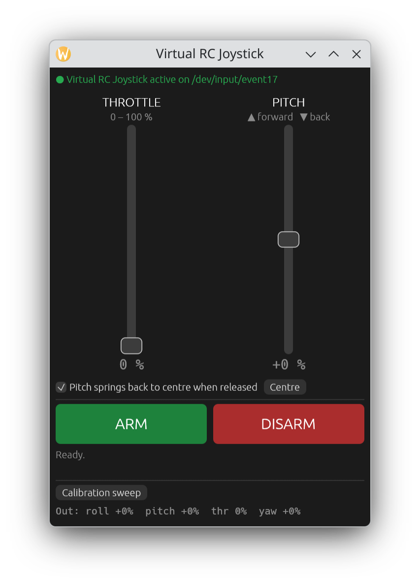

# Virtual RC Joystick

A small Rust app for flying RealFlight Evolution when the RadioMaster TX15 isn't
with you. It creates a virtual USB joystick through Linux `uinput`. Proton/Wine
sees it like any other game controller, so RealFlight can use it.



| Control | What it sends |
|---|---|
| **ARM** | Throttle fully down + yaw fully right, held for 4.5 s, then yaw back to centre. This is the same as holding the left stick down-right on the TX15. |
| **DISARM** | Throttle fully down + yaw fully left, held for 4.5 s. |
| **Throttle** slider | 0–100 %. Stays where you leave it. |
| **Pitch** slider | -100 % (stick back) to +100 % (stick forward). By default it springs back to centre when you let go, like the real stick. Untick the box to make it stay put. |
| **Calibration sweep** | Moves the axis chosen in the list next to it from end to end three times (6 s). Choose *All axes* for RealFlight's calibration wizard, or a single axis to find, map and calibrate that channel: then the other sticks stay centred and the throttle at idle. |
| **Cancel** / `Esc` | Stops an arm, disarm or sweep that's running. |

While a sequence runs, the sliders are locked. The arm hold is timed on its own
thread, so it stays accurate even when RealFlight covers the window.

## Build and run

```bash
cargo run --release
```

The binary is `target/release/virtual_joystick`. The virtual device exists only
while the app is open.

### Permissions

The app needs write access to `/dev/uinput`. On this machine, Steam's udev rule
(`60-steam-input.rules`) already grants it to the logged-in user, so no root is
needed. On a machine without Steam's rules, add this rule and then log out and
back in:

```bash
echo 'KERNEL=="uinput", SUBSYSTEM=="misc", TAG+="uaccess", OPTIONS+="static_node=uinput"' | sudo tee /etc/udev/rules.d/60-uinput.rules
```

## Setting it up in RealFlight Evolution

1. **Start the virtual joystick first, then start RealFlight.** Proton detects
   controllers when the game starts.
2. Run RealFlight in **windowed** mode so both windows are visible. To keep the
   joystick window above RealFlight in KDE, right-click its title bar and choose
   *More Actions → Keep Above Other Windows*.
3. In RealFlight's controller settings, pick **Virtual RC Joystick**. Ignore the
   *Virtual Flight Controller* device: it comes from another program.
   Don't use RealFlight's built-in *Gamepad* channel map: it is meant for
   Xbox-style pads. Use your own profile and map the channels as in step 5.
4. **Calibrate:**
   - When the wizard asks you to centre the controls, set the throttle slider to
     50 %. The other axes are already centred.
   - When it asks you to move all controls through their full range, choose
     *All axes* and click **Calibration sweep**. Wait for it to finish.
   - To calibrate one channel at a time, choose that axis instead.
   - Set the throttle back to 0 % before you fly.
5. **Map the channels.** To find an axis in RealFlight's channel list, choose
   it in the sweep list, for example *Pitch (axis 2, Y)*, and click
   **Calibration sweep**. For 6 s only that input moves; assign it to the
   function. The axis order matches an EdgeTX radio such as the TX15 in USB
   joystick mode with AETR channel order:

   | Function | Axis |
   |---|---|
   | Aileron / roll | 1 – X |
   | Elevator / pitch | 2 – Y |
   | Throttle | 3 – Z |
   | Rudder / yaw | 4 – RX |

   Axes 5–8 and the 8 buttons are spare: they stay centred and unpressed. Leave
   them unassigned.

   If pushing pitch forward makes the quad fly backwards, tick *Reverse* on the
   elevator channel. Do the same for the rudder channel if ARM doesn't work but
   DISARM arms the quad (yaw is reversed).

## Flying

1. Click **ARM** and wait for the progress bar to fill.
2. Raise the throttle slider.
3. Fly forward and back with the pitch slider.
4. Land, set the throttle to 0 % and click **DISARM**.

Roll and yaw stay centred outside the arm, disarm and calibration sequences.

## Known limitation: window focus

Clicking the joystick window takes keyboard focus away from RealFlight. Some
games stop reading controllers while they're in the background. This hasn't
been tested against RealFlight yet. If the quad stops responding while you use
the sliders, RealFlight is ignoring background input. Further work would be
needed to fix that, for example controlling the joystick with global keyboard
shortcuts.

## Tweaks

- Arm/disarm hold time: `ARM_HOLD` in `src/sticks.rs`. It's 4.5 s by default:
  the TX15 needs 4 s, plus a margin.
- Axis assignment and device name: `src/device.rs`. Keep the spare axes and
  buttons: RealFlight crashes when you calibrate a joystick that has only
  4 axes and 1 button. With 8 axes and 8 buttons, the device has the same
  shape as a radio in joystick mode.
- USB IDs: `VENDOR_ID`/`PRODUCT_ID` in `src/device.rs` (pid.codes test IDs).
  RealFlight stores calibration and channel maps per VID/PID. Change the PID
  when you change the device layout, so RealFlight sets it up as a new
  controller.

## Tests

```bash
cargo test                 # stick logic: arm/disarm timing, axis mapping, calibration sweeps
cargo test -- --ignored    # creates the real uinput device and reads it back as a game would
```
